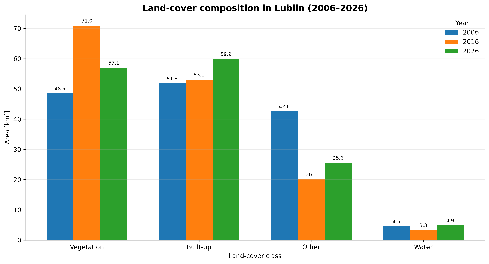
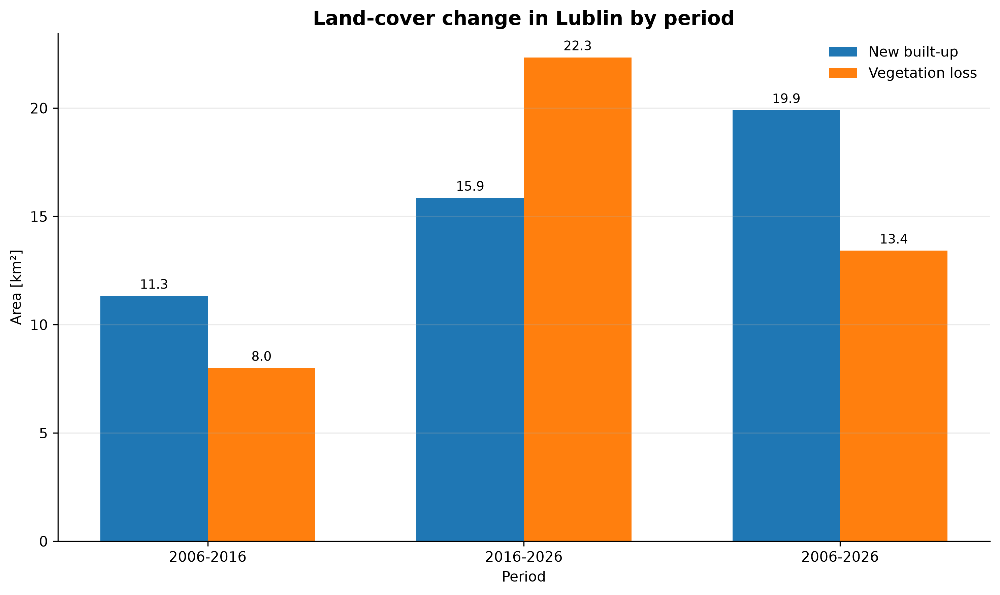
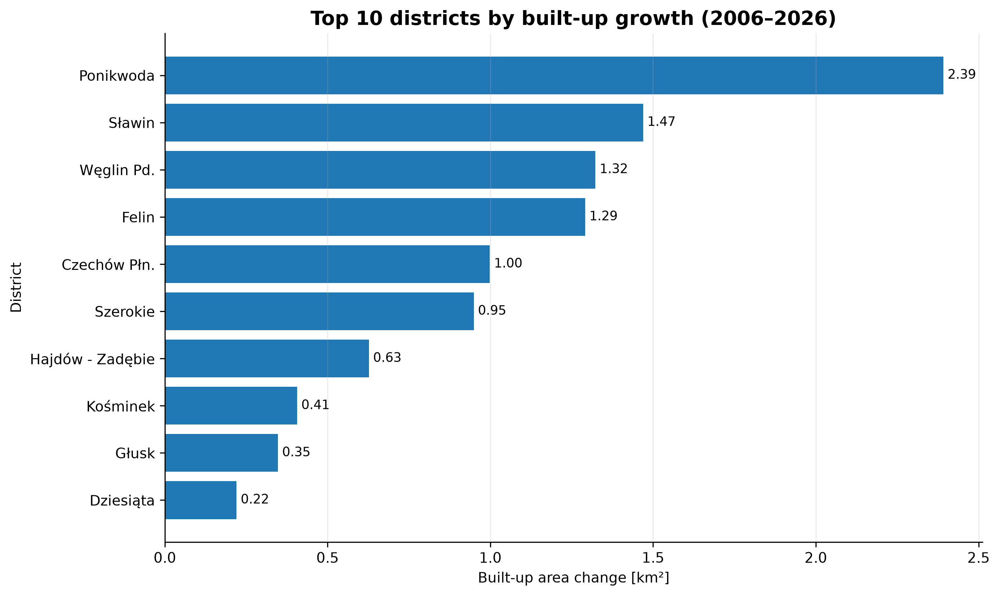
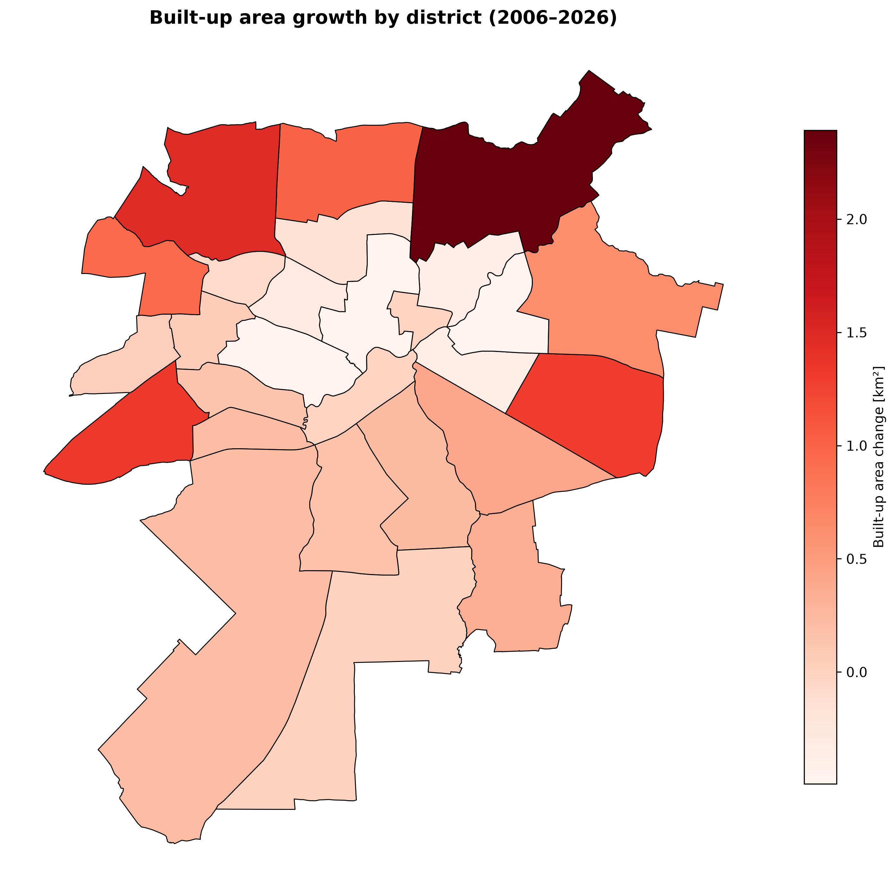
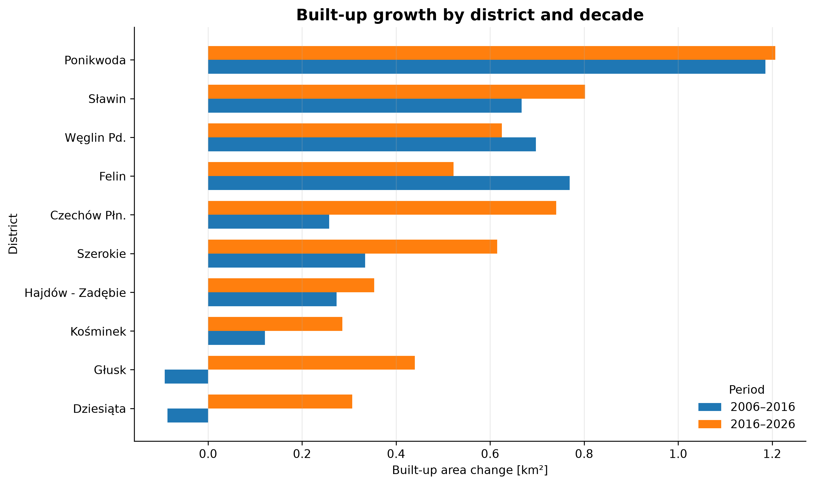
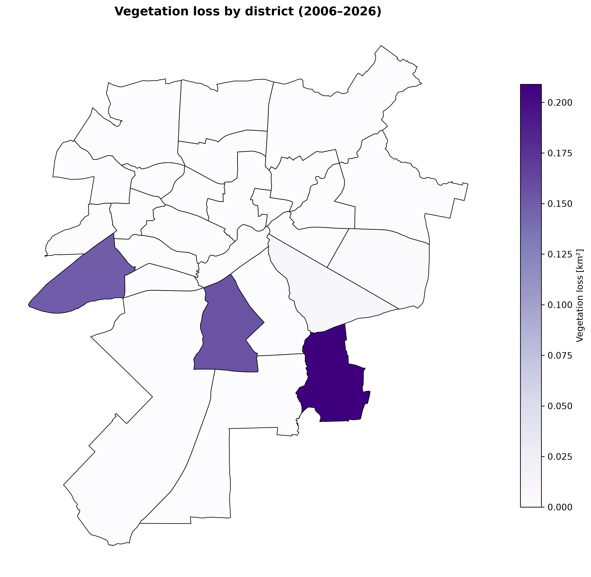

# Urban Growth and Green Space Change in Lublin, 2006–2026

[Polish version](README_PL.md)

## Project overview

This project presents an analysis of land-cover change and urban growth in Lublin between 2006 and 2026 using Landsat satellite imagery, Google Earth Engine and Python GIS tools.

The analysis was carried out for three reference years:

- 2006,
- 2016,
- 2026.

The main objective of the project was to determine how the spatial structure of Lublin changed over 20 years, with particular focus on the increase in built-up areas and changes in areas classified as vegetation.

The analysis covers both the entire city and its 27 districts.

Land cover was divided into four classes:

- **vegetation** — vegetation,
- **built-up** — built-up areas,
- **other** — other land-cover types,
- **water** — water.

---

## Project objectives

The main objectives of the analysis were:

- preparing comparable Landsat composites for 2006, 2016 and 2026,
- calculating NDVI and NDBI spectral indices,
- performing exploratory K-means analysis,
- carrying out supervised land-cover classification using Random Forest,
- evaluating classification quality,
- identifying land-cover changes between the analyzed periods,
- determining the area of newly classified built-up land,
- analyzing changes in vegetation area,
- comparing changes between the districts of Lublin,
- preparing tables, maps and charts summarizing the results.

---

## Study area

The study area is the administrative area of **Lublin, Poland**.

The city boundary was created by merging the official boundaries of Lublin's 27 districts.

The area of the resulting city boundary is approximately:

**147.48 km²**

Administrative boundaries were also used to calculate spatial statistics for individual districts.

---

## Data

### Satellite data

The project uses **Landsat Collection 2 Level-2 Surface Reflectance** data available in Google Earth Engine.

The following datasets were used for each year:

| Year | Sensor | Google Earth Engine collection |
|---|---|---|
| 2006 | Landsat 5 TM | `LANDSAT/LT05/C02/T1_L2` |
| 2016 | Landsat 8 OLI | `LANDSAT/LC08/C02/T1_L2` |
| 2026 | Landsat 8 OLI | `LANDSAT/LC08/C02/T1_L2` |

For each year, observations from the summer period were used:

**June 1 – August 31**

Using the same season reduces the influence of vegetation seasonality on comparisons between years.

### Administrative boundaries

District boundaries come from official GIS data provided by the City of Lublin.

The input data were stored in:

**ETRS89 / Poland CS2000 zone 8 — EPSG:2179**

For Google Earth Engine processing, geometries were subsequently transformed to **EPSG:4326**.

---

## Technologies

The project was developed using:

- Python,
- Google Earth Engine Python API,
- geemap,
- GeoPandas,
- pandas,
- NumPy,
- Matplotlib,
- scikit-learn,
- Jupyter Notebook,
- Visual Studio Code.

---

## Methodology

### 1. City boundary preparation

The official district boundaries of Lublin were merged using the `dissolve` operation to create a single geometry representing the city area.

The correctness of the resulting boundary was verified by comparing the total area of all districts with the area of the dissolved city boundary.

---

### 2. Landsat data preparation

For each year, the following steps were performed:

- filtering imagery to the Lublin city boundary,
- filtering imagery to the summer period,
- cloud masking,
- cloud-shadow masking,
- snow masking,
- radiometric saturation masking,
- Surface Reflectance value scaling,
- harmonization of band names between Landsat 5 and Landsat 8.

The common set of bands was:

- `blue`,
- `green`,
- `red`,
- `nir`,
- `swir1`,
- `swir2`.

A **seasonal median composite** was then created for each year.

---

### 3. Valid observation count quality control

For each year, the number of valid observations available for each pixel after applying the quality masks was checked.

The average number of valid observations was approximately:

| Year | Mean number of valid observations |
|---|---:|
| 2006 | 3.72 |
| 2016 | 4.57 |
| 2026 | 3.68 |

There were no pixels within the study area with zero valid observations.

---

### 4. Spectral indices

Two spectral indices were added to the composites.

#### NDVI

Normalized Difference Vegetation Index:

```text
NDVI = (NIR - RED) / (NIR + RED)
```

This index is used to identify areas covered by vegetation.

#### NDBI

Normalized Difference Built-up Index:

```text
NDBI = (SWIR1 - NIR) / (SWIR1 + NIR)
```

This index supports the identification of built-up surfaces.

The indices were calculated using mathematical expressions instead of the `normalizedDifference` function to avoid automatic masking of negative reflectance values occurring after Landsat Collection 2 scaling.

---

## Exploratory K-means analysis

Before supervised classification, an exploratory K-means clustering analysis was performed.

The analysis used a combined sample of approximately 15,000 pixels from the three analyzed years.

The data were standardized before clustering.

Values of `k` from 2 to 8 were evaluated using:

- inertia,
- silhouette score.

Finally, **k = 4** was selected as a compromise between the structure of the data and the planned thematic classification.

K-means clusters were treated only as spectral groups and were not directly assigned to land-cover classes.

---

## Random Forest classification

The final classification was performed using the **Random Forest** algorithm.

The following predictors were used:

- blue,
- green,
- red,
- nir,
- swir1,
- swir2,
- NDVI,
- NDBI.

Training samples were manually digitized and saved as polygons for four classes:

| Class | ID |
|---|---:|
| Vegetation | 0 |
| Built-up | 1 |
| Other | 2 |
| Water | 3 |

A total of **52 reference polygons** were prepared.

They were divided into independent training and testing datasets.

The Random Forest model contained:

**200 trees**

and was trained on a combined multi-year sample.

The same classifier was applied to 2006, 2016 and 2026 to improve temporal consistency and reduce differences caused by independently trained models for individual years.

---

## Classification validation

The model was evaluated using an independent testing sample.

The results were:

- **Overall Accuracy: 96.09%**
- **Kappa: 0.944**

Confusion matrix:

|  | Pred. Vegetation | Pred. Built-up | Pred. Other | Pred. Water |
|---|---:|---:|---:|---:|
| Vegetation | 272 | 2 | 10 | 4 |
| Built-up | 0 | 218 | 4 | 0 |
| Other | 21 | 4 | 125 | 0 |
| Water | 0 | 0 | 0 | 492 |

The lowest producer accuracy was obtained for the **other** class, which is the most spectrally heterogeneous and may include exposed soil, agricultural surfaces and dry non-built-up areas.

---

# Results

## Changes in land-cover structure

The results indicate substantial changes in the land-cover structure of Lublin between 2006 and 2026.

Approximate class areas for the entire city were:

| Class | 2006 [km²] | 2016 [km²] | 2026 [km²] |
|---|---:|---:|---:|
| Vegetation | 48.5 | 71.0 | 57.1 |
| Built-up | 51.8 | 53.1 | 59.9 |
| Other | 42.6 | 20.1 | 25.6 |
| Water | 4.5 | 3.3 | 4.9 |

Across the entire analyzed period, an increase in the area classified as built-up is visible.

Changes in the `vegetation` and `other` classes are more complex and should be interpreted carefully due to seasonality, the character of agricultural land, spectral differences and the spatial resolution of Landsat imagery.



---

## Newly classified built-up areas

New built-up areas were defined as pixels that did not belong to the `built-up` class in the initial year but were classified as `built-up` in the final year.

The results were:

| Period | Newly classified built-up area |
|---|---:|
| 2006–2016 | 11.32 km² |
| 2016–2026 | 15.85 km² |
| 2006–2026 | 19.90 km² |

The results indicate that the area transitioning into the `built-up` class was larger during **2016–2026** than during **2006–2016**.

The value for 2006–2026 is not the sum of the two ten-year periods. It represents a direct comparison between the 2006 and 2026 classifications.



---

## Built-up area changes by district

The largest increases in `built-up` area between 2006 and 2026 occurred, among others, in the following districts:

| District | Built-up change [km²] |
|---|---:|
| Ponikwoda | +2.39 |
| Sławin | +1.47 |
| Węglin Południowy | +1.32 |
| Felin | +1.29 |
| Czechów Północny | +1.00 |
| Szerokie | +0.95 |
| Hajdów-Zadębie | +0.63 |
| Kośminek | +0.41 |
| Głusk | +0.35 |
| Dziesiąta | +0.22 |

The largest increases in the percentage share of built-up area were observed, among others, in **Szerokie**, **Węglin Południowy** and **Ponikwoda**.





---

## Comparison of the two decades

The analysis was also performed separately for:

- 2006–2016,
- 2016–2026.

This makes it possible to assess whether built-up growth occurred evenly over time.

In both periods, strong growth was visible, among others, in Ponikwoda, Sławin, Węglin Południowy and Felin.

During 2016–2026, substantial growth was also visible in Zemborzyce, Czechów Północny and Abramowice.

The results therefore indicate both the persistence of some earlier development zones and the emergence of stronger changes in additional districts during the second decade.



---

## Vegetation changes

In the change analysis, a pixel was classified as vegetation loss if:

- it belonged to the `vegetation` class in the initial year,
- it belonged to another class in the final year.

The area of such changes was:

| Period | Vegetation → other class |
|---|---:|
| 2006–2016 | 8.00 km² |
| 2016–2026 | 22.34 km² |
| 2006–2026 | 13.41 km² |

These values do not automatically represent permanent loss of green space.

A transition from `vegetation` to `other` may be related to seasonal differences, agricultural land, dry vegetation, exposed soil or classification differences.

Therefore, the most direct signal of urbanization is the transition of surfaces into the `built-up` class rather than every transition out of the `vegetation` class.

---

## Districts with vegetation decline

In the direct 2006–2026 comparison, a decline in the total area classified as `vegetation` occurred only in some districts.

The largest declines were observed, among others, in:

- Głusk,
- Wrotków,
- Węglin Południowy.




---

## Key findings

The analysis indicates a clear increase in areas classified as built-up in Lublin between 2006 and 2026.

The strongest changes were not evenly distributed across the city. Particularly large increases in `built-up` area were visible in several districts outside the most compact central part of the city, including Ponikwoda, Sławin, Węglin Południowy, Felin and Szerokie.

The rate at which surfaces transitioned into the `built-up` class was higher during 2016–2026 than during 2006–2016.

Changes in areas classified as `vegetation` were more complex. Not every loss of the `vegetation` class represents direct urbanization, because some changes occurred between vegetation and the `other` class.

The results show that combining multi-temporal Landsat data, Random Forest classification, change detection and district-level statistics provides an effective framework for analyzing long-term spatial changes in an urban area.

---

## Analysis limitations

The results should be interpreted with several limitations in mind.

### Spatial resolution

Landsat imagery has a spatial resolution of approximately **30 m**.

A single pixel may therefore contain several land-cover types at the same time, for example a building, a road and vegetation.

### Mixed pixels

Mixed pixels are common in urban areas, which may lead to ambiguity between the `built-up`, `vegetation` and `other` classes.

### Different sensors

The year 2006 is analyzed using Landsat 5 TM, while 2016 and 2026 use Landsat 8 OLI.

The bands were functionally harmonized, but the sensors are not identical.

### Nature of the `other` class

The `other` class includes heterogeneous surfaces such as:

- exposed soil,
- dry surfaces,
- some agricultural land,
- other surfaces that do not clearly match the remaining classes.

This may increase the variability of this class between years.

### Interpretation of changes

The detected changes represent **land-cover classification changes in Landsat data**, not an exact inventory of new buildings or cadastral changes.

In particular:

- `vegetation → other` does not necessarily represent permanent green-space loss,
- `other → built-up` may represent urbanization, but the result has a 30 m spatial resolution,
- the results should not be interpreted as the exact area of building footprints.

---

## Project structure

```text
lublin-urban-growth/
│
├── data/
│   ├── boundaries/
│   │   ├── city/
│   │   └── districts/
│   └── training/
│
├── notebooks/
│   ├── 00_build_city_boundary.ipynb
│   ├── 01_data_preparation.ipynb
│   ├── 02_indices_classification.ipynb
│   ├── 03_change_detection.ipynb
│   └── 04_statistics_visualization.ipynb
│
├── outputs/
│   ├── figures/
│   └── tables/
│
├── src/
│   └── gee_utils.py
│
├── .gitignore
├── requirements.txt
├── README.md
└── README_PL.md
```

---

## Notebooks

### `00_build_city_boundary.ipynb`

Preparation of the administrative city boundary by merging district boundaries.

### `01_data_preparation.ipynb`

Preparation of Landsat data, scene availability checks, preprocessing and composite generation.

### `02_indices_classification.ipynb`

Calculation of NDVI and NDBI, K-means analysis, preparation of training data, and Random Forest training and validation.

### `03_change_detection.ipynb`

Classification of individual years and analysis of transitions between land-cover classes.

### `04_statistics_visualization.ipynb`

District-level statistics, result aggregation, charts and final maps.

---

## Project outputs

Output files are stored in:

```text
outputs/
```

### Tables

```text
outputs/tables/
├── built_up_growth_by_decade.csv
├── district_change_2006_2016.csv
├── district_change_2006_2026.csv
├── district_change_2016_2026.csv
└── district_landcover_statistics.csv
```

### Visualizations

```text
outputs/figures/
├── built_up_growth_by_decade.png
├── district_built_up_growth_2006_2026.png
├── district_vegetation_loss_2006_2026.png
├── land_cover_composition_2006_2026.png
├── new_built_up_vs_vegetation_loss.png
├── top10_built_up_growth_2006_2026.png
└── vegetation_decline_2006_2026.png
```

---

## Running the project

### 1. Clone the repository

```bash
git clone <repository-url>
cd lublin-urban-growth
```

### 2. Create a virtual environment

```bash
python -m venv .venv
```

Windows:

```bash
.venv\Scripts\activate
```

### 3. Install dependencies

```bash
pip install -r requirements.txt
```

### 4. Authenticate Google Earth Engine

Before the first run, a Google Earth Engine-enabled account and authentication for the Earth Engine Python API are required.

### 5. Run the notebooks

The notebooks should be executed in the following order:

```text
00_build_city_boundary.ipynb
01_data_preparation.ipynb
02_indices_classification.ipynb
03_change_detection.ipynb
04_statistics_visualization.ipynb
```

Each notebook uses outputs prepared during the previous stages of the analysis.

---

## Reproducibility

Reusable Google Earth Engine processing components were moved to:

```text
src/gee_utils.py
```

The module contains functions responsible for:

- Landsat 5 preprocessing,
- Landsat 8 preprocessing,
- NDVI and NDBI calculation,
- composite generation,
- reference-data splitting,
- training-sample extraction.

This reduces code duplication and ensures methodological consistency between notebooks.

---

## Possible future extensions

The project could be further extended by:

- using Sentinel-2 to validate the most recent classification,
- analyzing additional intermediate years,
- performing a more detailed classification of built-up types,
- analyzing changes at the neighborhood level or using a regular grid,
- combining land-cover changes with demographic data,
- analyzing accessibility to green spaces,
- analyzing land surface temperature and the urban heat island effect,
- publishing the results in an interactive Web GIS application.

---


GIS / Remote Sensing portfolio project developed using Landsat data, Google Earth Engine and Python.
